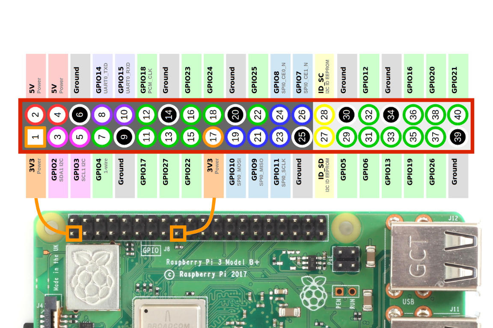
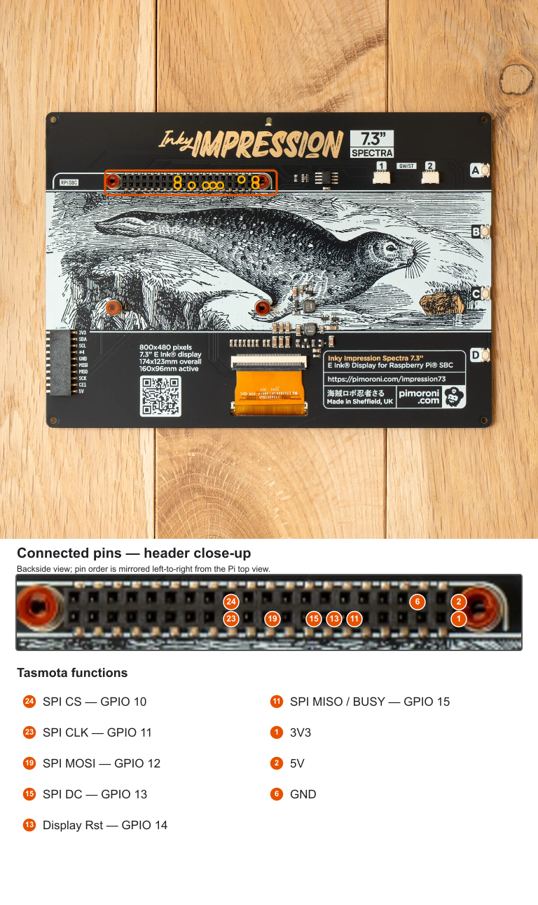

# Inky Impression JPEG dithering

[inky_dither.be](./inky_dither.be) converts a JPEG image for the 7.3-inch Inky Impression display with the E673 controller. It applies Floyd–Steinberg dithering to the six colors used by the Inky E673 Python driver, then saves the result as a JPEG.

## Requirements

- An ESP32 Tasmota build with features (`USE_DISPLAY`, `USE_UNIVERSAL_DISPLAY`, `USE_UFILESYS`, `USE_BERRY_IMAGE` and `JPEG_PICTS`) enabled. These are compile-time options and cannot be enabled by loading the script. The script sends the quantized RGB888 buffer directly to the universal display and saves a JPEG copy separately.
- PSRAM is required for the decoded RGB image buffer. An 800 × 480 buffer uses about 1.15 MiB, in addition to memory needed by JPEG decoding and encoding.
- The source must be a JPEG that decodes to RGB888. Images are resized to the logical dimensions selected by `display.ini` and dithered. uDisplay applies the configured panel rotation when drawing; source-image orientation is not inferred automatically.
- Resizing stretches the image to the requested dimensions without preserving its aspect ratio. It averages source pixels when shrinking to reduce aliasing and interpolates when enlarging. JPEG decoding can still select a reduced resolution when PSRAM is limited, which may lose detail before resizing. Source and destination buffers must both fit in PSRAM during resizing.
- Firmware must export `display.width()`, `display.height()`, `display.draw_rgb888_async()` and `display.refresh_status()`, and include the current `InkyDither.dither` implementation, which accepts the logical dimensions after rotation (480 × 800 for Inky 7.3 with `DisplayRotate 1`). Disable Tasmota's default startup splash screen using `SetOption135 1`. This disables the splash screen, not the Inky refresh when a new image is displayed.
- Without an initialized display, the script saves a dithered 480 × 800 image for Inky 7.3 with `DisplayRotate 1` and skips panel drawing. The physical panel resolution is 800 × 480.
- Berry's `bytes()` limit restricts the compressed source JPEG to 512 KiB. PSRAM is required for this workflow.

## Inky Impression 7.3-inch display

- `Inky_Impression_7_3_display.ini` supports the 800x480 Inky Impression 7.3-inch Spectra 6 display with the E673 controller. It uses the universal uDisplay SPI driver and expects the display reset pin and the active-low BUSY signal to be configured to the usual display `SPI` pins. With a 90° or 270° rotation in `display.ini`, the logical image dimensions become 480 × 800.

### Tasmota GPIO configuration and wiring

The Inky's `BUSY` signal is a separate panel status output; it is not SPI MISO data. The current uDisplay descriptor uses the Tasmota `SPI MISO` GPIO as the input for this signal, so connect Inky `BUSY` to the ESP GPIO configured as `SPI MISO`. The driver reads that pin as a GPIO while waiting for the panel; it does not read display data over MISO.

Configure the Tasmota GPIO functions to match the signals you wired (Example config for ESP32-S3):

| Inky E673 signal | Raspberry Pi header pin | Tasmota GPIO function | ESP32-S3 GPIO | Dupont Cable color |
| --- | --- | --- | --- | --- |
| `CS` / `CS0` | pin 24 | `SPI CS` | `GPIO 10` | grey |
| `SCLK` | pin 23 | `SPI CLK` | `GPIO 11` | lila |
| `MOSI` / `DIN` | pin 19 | `SPI MOSI` | `GPIO 12` | green |
| `D/C` | pin 15 | `SPI DC` | `GPIO 13` | blue |
| `RESET` | pin 13 | `Display Rst` | `GPIO 14` | yellow |
| `BUSY` | pin 11 | `SPI MISO` | `GPIO 15` | white |
| `3V3` | pin 1 | `3V3` | `3V3` | orange |
| `5V` | pin 2 | `5V` | `5V` | red |
| `GND` | pin 6 | `GND` | `GND` | brown |




Assign each Tasmota function to the ESP GPIO physically wired to that Inky signal, using **Configure Module** (or the equivalent GPIO configuration for your device). The middle column documents the Raspberry Pi 40-pin header locations; these are not ESP32 GPIO numbers. Choose suitable GPIOs for your ESP32 wiring and assign the Tasmota functions accordingly. In particular, ensure that `SPI MISO` is assigned even though the panel has no MISO data output.

Upload [inky_dither.be](./inky_dither.be) and the source JPEG to the Tasmota filesystem. The examples below assume both files are in the filesystem root.

## Run from the Berry console

Load the script, then call `inky_dither()` with the input and output paths:

```berry
load("inky_dither.be")
var result = inky_dither("/image.jpg", "/image-dithered.jpg")
print(result)
```

The script draws the quantized RGB888 buffer directly to the display before JPEG encoding, so compression cannot change the image shown on the panel. It starts the panel refresh asynchronously, then saves a JPEG copy in the Tasmota filesystem; retrieve it using the device's filesystem access method. JPEG quality only affects this saved copy. Panel BUSY waits are serviced by Tasmota's main loop, so MQTT, rules, and web requests can run during the roughly 32-second physical refresh. The 192,000-byte framebuffer transfer still runs in one synchronous SPI operation.

The returned `refresh_status` is usually `running` when the script finishes. Check it later with `display.refresh_status()`; it changes to `complete` or `failed`. The returned `displayed` field is true only when the refresh has completed by the time the result is assembled. The driver also writes completion or failure to the log. While a refresh is running, drawing, rotation, another refresh, and display reinitialization are rejected or ignored to protect the framebuffer and panel state.

Dithering is performed by the native `InkyDither.dither` class. It uses serpentine Floyd–Steinberg error diffusion with fixed-point error accumulation, reducing directional artifacts and rounding loss. Its two temporary error rows require 24 bytes per image column (about 18.75 KiB at 800 pixels); allocation failure raises `memory_error` before the pixel buffer is changed. Corrected channels are limited to the RGB range before quantization, preventing unbounded error buildup for colors outside the display palette. Image resizing uses the native `img.resize()` method to keep its large working buffer in PSRAM; the firmware must include the updated Berry image module.

When using `img.resize()` directly, discard any `bytes` views mapped to the old `info()["buf_addr"]` before resizing and obtain a fresh address afterward: a successful resize can replace the underlying buffer. If resizing fails, the original image remains unchanged.

The six-color palette and saturation blend follow the [Pimoroni E673 driver](https://github.com/pimoroni/inky/blob/master/inky/inky_e673.py). As [Pimoroni's display guide](https://learn.pimoroni.com/article/getting-started-with-inky-impression) notes, display appearance depends on the image and lighting; increasing image contrast and saturation before conversion can help. The [Floyd–Steinberg overview](https://en.wikipedia.org/wiki/Floyd%E2%80%93Steinberg_dithering) describes the error weights, adequate error precision, and serpentine scanning. The saved JPEG is only a preview: it encodes the six RGB identifier colors rather than the measured panel colors.

If `load("inky_dither.be")` fails with `img undeclared`, the running firmware does not provide the Berry `img` class. Confirm that it was built with `USE_BERRY_IMAGE` enabled, then rebuild and flash it. The failure occurs while Berry compiles the script, before `inky_dither()` runs.

## Parameters

```berry
inky_dither(input_path, output_path, saturation, jpeg_quality, width, height, draw_to_display)
```

- `input_path`: path to the source JPEG on the Tasmota filesystem. The compressed source must not exceed Berry's 512 KiB `bytes()` limit.
- `output_path`: destination path for the dithered JPEG. It may be the same as the input path.
- `saturation`: palette blend from `0.0` to `1.0`. `0.5` matches the Python driver's default. Lower values use the desaturated palette; higher values increase saturation.
- `jpeg_quality`: software JPEG encoder quality from `1` to `100`. Higher values preserve more image detail and generally produce larger files. The default is `85`.
- `width` and `height`: optional logical output dimensions, which must be supplied together. If omitted, the function uses the initialized display dimensions or falls back to 480 × 800 when no display is initialized.
- `draw_to_display`: optional boolean. Defaults to drawing when display dimensions are detected; with explicit dimensions or the no-display fallback, it defaults to `false` and only saves the JPEG.

Berry does not support default values in function declarations. Omit the optional arguments or pass `nil` to use the defaults. For example, `inky_dither("/image.jpg", "/image-dithered.jpg", nil, 90)` uses the default saturation and JPEG quality `90`.

For example, use a more saturated palette and a smaller, more compressed JPEG:

```berry
var result = inky_dither("/image.jpg", "/image-dithered.jpg", 0.75, 70)
print(result)
```

The function returns the output `path`, `width`, `height`, encoded file size in `bytes`, `displayed`, and `refresh_status`. JPEG is lossy, so the saved file can contain slight color changes from the six dither palette colors even though the displayed image uses the original quantized buffer. Higher `jpeg_quality` values reduce these changes at the cost of a larger file.
